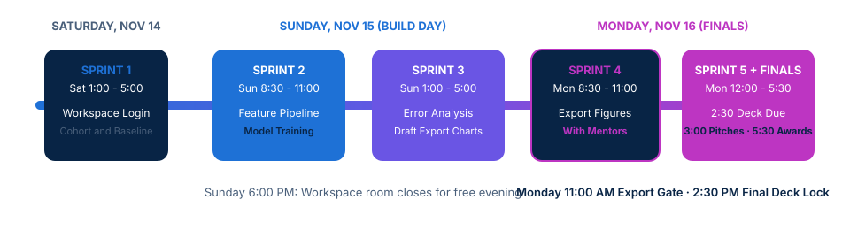

<!-- course-title: 2026 Mayo Clinic Platform Surgical Innovation Challenge -->
<!-- course-theme: roi-alt-theme -->

<!-- layout: title -->


2026 Mayo Clinic Platform Surgical Innovation Challenge

# Chapter 1: Surgical Innovation Challenge Run of Show

---

# Chapter 1: Objectives

- Navigate the event schedule, workspace rules, de-identified datasets, and build sprint milestones from kickoff to final presentations
- Follow the opening keynote and challenge topic briefings to align on clinical problem areas
- Apply platform AI governance, export restrictions, de-identification rules, and workspace access procedures
- Leverage Google Cloud tools and complete the first build sprint milestone
- Execute continuous prototyping and model refinement across Sunday build sprints
- Finalize export figures, submit presentation decks, and deliver final challenge demonstrations

---

<!-- layout: navigation -->
# Chapter 1

- **Saturday, Nov 14: Kickoff and Onboarding**
- Data and Workspace Introduction (Mayo Clinic Platform TSMs, 10:00–11:20)
- Google Tools Introduction and Saturday Build Sprint
- Sunday, Nov 15: Build Day
- Monday, Nov 16: Finals and Awards

---

<!-- layout: card-layout -->
# Three-Day Challenge Run of Show: Rochester, MN

### Saturday, Nov 14: Kickoff and Onboarding
- Align on surgical challenge themes during the opening keynote and clinical briefings from 8:30 to 9:50 AM.
- Complete Mayo Clinic Platform governance onboarding, Google tools walkthrough, and Build Sprint 1 before the 5:00 PM welcome reception.

### Sunday, Nov 15: Full Build Day
- Focus exclusively on hands-on experimentation across Build Sprint 2 (8:30 to 11:00 AM) and Build Sprint 3 (1:00 to 5:00 PM).
- Validate clinical cohorts, refine models with mentors, and prepare candidate figures before the room closes at 6:00 PM.

### Monday, Nov 16: Finals and Awards
- Submit figures for export with mentors in Build Sprint 4 (8:30 to 11:00 AM) and polish pitches in Build Sprint 5 (12:00 to 2:30 PM).
- Deliver final presentations from 3:00 to 5:00 PM, followed by judge deliberation at 5:00 PM and the awards ceremony at 5:30 PM.

---

<!-- layout: 2-column -->
# Saturday Morning: Kickoff and Clinical Briefings

### 8:30 to 9:10 AM: Opening Keynote
- **Session**: Welcoming Remarks and Opening Keynote - *Mayo Clinic Platform and the Power of Data*
- **Speaker**: Dr. Gelareh Zadeh (live speaker deck handoff)
- **Focus**: How large-scale clinical datasets and platform engineering accelerate surgical discovery and patient outcomes

### 9:10 to 9:50 AM: Challenge Topic Briefings
- **Session**: *From Clinical Insight to Impact*
- **Speaker**: Dr. Kyle Ettinger (live speaker deck handoff)
- **Focus**: Core surgical problem statements, clinical workflows, and what judges look for in actionable AI prototypes

<!-- below-columns -->

> [!NOTE]
> Morning break runs from 9:50 to 10:00 AM. Be back in your seats at 10:00 AM sharp for mandatory workspace and export onboarding.

---

<!-- layout: navigation -->
# Chapter 1

- Saturday, Nov 14: Kickoff and Onboarding
- **Data and Workspace Introduction (Mayo Clinic Platform TSMs, 10:00–11:20)**
- Google Tools Introduction and Saturday Build Sprint
- Sunday, Nov 15: Build Day
- Monday, Nov 16: Finals and Awards

---

<!-- layout: 3-column -->
# Data and Workspace Introduction (10:00 to 11:20 AM)

### AI Policy and Exports (~31 min)
- **Behind Glass and AI Policy**: operating boundaries inside the secure Mayo Clinic Platform environment
- **Export Rules: What Can Leave**: strict separation between in-enclave data and external artifacts
- **Using the Export Template**: how to package summary figures for mentor and TSM approval

### De-Identified Data (~22 min)
- **What Is in the Dataset**: surgical procedures, patient cohorts, and longitudinal clinical timelines
- **De-Identifying Structured Data**: date shifting, rare-value masking, and safe cohort aggregation
- **Clinical Notes**: working responsibly with de-identified unstructured surgical text

### The Data Workspace (~41 min)
- **Your Workspace and Logging In**: authenticating to your team virtual machine and cloud project
- **Live Demo**: navigating datasets, notebooks, and shared team storage
- **Surgery Data Essentials**: key tables, joins, working smart, and immediate next steps

<!-- below-columns -->

> [!IMPORTANT]
> Led by Mayo Clinic Platform Technical Solutions Managers (TSMs). Every participant must follow these governance rules throughout all five build sprints.

---

# Behind Glass Governance and Export Rules

- All data exploration, feature engineering, and model training occur strictly inside the Behind Glass workspace
- Row-level patient records, raw clinical notes, and unreviewed artifacts can never leave the environment
- Only aggregate charts, summary metrics tables, and reviewed visuals may be exported for your final deck
  - Every export request must use the official Export Template and pass mentor review during Build Sprint 4
  - Attempting to copy raw data outside the workspace or re-identify patients violates platform policy


---

<!-- layout: navigation -->
# Chapter 1

- Saturday, Nov 14: Kickoff and Onboarding
- Data and Workspace Introduction (Mayo Clinic Platform TSMs, 10:00–11:20)
- **Google Tools Introduction and Saturday Build Sprint**
- Sunday, Nov 15: Build Day
- Monday, Nov 16: Finals and Awards

---

# Google Tools Introduction: Live Demo and Antigravity CLI (11:20 to 12:00)

- Live hands-on walkthrough led by the Google team (no slide deck - live terminal and workspace screen share)
- Covers Google Cloud environment setup, AI development workflows, and the Antigravity CLI inside your virtual machine
- Google engineers remain on-site across all five build sprints to assist teams with cloud tools and model pipelines

```bash
# Confirm active Google Cloud account and workspace project inside your VM
gcloud config list

# Inspect available surgical dataset tables and verify Antigravity CLI access
bq ls
antigravity --help
```

> [!TIP]
> Follow along in your team VM during the 11:20 AM walkthrough so your environment is verified before lunch.

---

<!-- layout: 2-column -->
# Saturday Afternoon: Build Sprint 1 and Welcome Reception

### 12:00 to 5:00 PM: Lunch and Build Sprint 1
- **12:00 to 1:00 PM**: Lunch
- **1:00 to 5:00 PM**: Build Sprint 1 (4 hours)
- Verify every team member can log in, access the VM, and query the surgical tables
- Define your clinical problem statement, narrow your target surgical cohort, and run a baseline exploration script

### 5:00 to 7:00 PM: Welcome Reception
- **5:00 to 7:00 PM**: Evening welcome reception
- Save notebooks, commit code inside your workspace repository, and document open clinical questions for Sunday
- Connect with clinicians, Mayo Clinic Platform TSMs, Google mentors, and fellow teams

---

<!-- layout: navigation -->
# Chapter 1

- Saturday, Nov 14: Kickoff and Onboarding
- Data and Workspace Introduction (Mayo Clinic Platform TSMs, 10:00–11:20)
- Google Tools Introduction and Saturday Build Sprint
- **Sunday, Nov 15: Build Day**
- Monday, Nov 16: Finals and Awards

---

<!-- layout: stacked -->
# Sunday, Nov 15: Full Build Day Schedule

- **7:30 AM**: Breakfast opens
- **8:30 to 11:00 AM**: Build Sprint 2 - cohort validation, feature pipelines, and core model training
- **12:00 PM**: Lunch
- **1:00 to 5:00 PM**: Build Sprint 3 - clinical evaluation, subgroup error analysis, and drafting candidate export figures
- **6:00 PM**: Workspace room closes; free evening for teams



---

<!-- layout: card-layout -->
# Working Smart Across Sunday Build Sprints

### Sprint 2: Cohort and Baseline Model
- Lock your inclusion and exclusion criteria on the de-identified surgical dataset before scaling training runs.
- Pair early with Mayo Clinic Platform TSMs to validate table joins and clinical note preprocessing.

### Sprint 3: Evaluation and Draft Figures
- Evaluate model performance on clinically meaningful metrics rather than accuracy alone.
- Generate draft summary plots and check that no chart exposes individual patient rows or small-cell counts.

### On-Site Mentor Support
- Consult clinical mentors to test whether your prototype fits real pre-operative, intra-operative, or post-operative workflows.
- Tap the Google team during Sprints 2 and 3 for Antigravity CLI troubleshooting, prompt tuning, and VM optimization.

---

<!-- layout: navigation -->
# Chapter 1

- Saturday, Nov 14: Kickoff and Onboarding
- Data and Workspace Introduction (Mayo Clinic Platform TSMs, 10:00–11:20)
- Google Tools Introduction and Saturday Build Sprint
- Sunday, Nov 15: Build Day
- **Monday, Nov 16: Finals and Awards**

---

<!-- layout: 2-column -->
# Monday Morning: Final Build Sprints and Deck Submission

### 7:30 to 11:00 AM: Breakfast and Build Sprint 4
- **7:30 AM**: Breakfast
- **8:30 to 11:00 AM**: Build Sprint 4 - Submit Figures for Export with Mentors
- Package final charts and summary metrics using the official Export Template
- Review and submit all candidate figures with your mentors before Sprint 4 concludes at 11:00 AM

### 11:00 AM to 2:30 PM: Lunch, Sprint 5, and Deck Lock
- **11:00 AM**: Lunch
- **12:00 to 2:30 PM**: Build Sprint 5 - Presentation Coaching
- Rehearse your clinical narrative, methodology, and live pitch timing with mentors
- **2:30 PM**: Final presentation deck submission deadline

<!-- below-columns -->

> [!WARNING]
> Do not wait until afternoon to request data exports. Figures for your presentation must be submitted with mentors during Build Sprint 4 (8:30 to 11:00 AM) and decks lock at 2:30 PM.

---

<!-- layout: 3-column -->
# Monday Afternoon: Final Presentations and Awards

### 3:00 to 5:00 PM: Final Presentations
- Teams present their surgical AI innovations to the judging panel and cohort
- Lead with the clinical problem, dataset approach, validation results, and surgical impact
- Include only approved figures cleared through the Export Template workflow

### 5:00 to 5:30 PM: Judge Deliberation
- Judging panel convenes to score technical rigor, clinical utility, and presentation clarity
- Teams network and debrief in the main event space while scores are finalized

### 5:30 PM: Awards and Reception
- Announcement of 2026 Mayo Clinic Platform Surgical Innovation Challenge winners
- Closing remarks, awards ceremony, and celebratory reception

---

# What You Learned

- Navigated the event schedule, workspace rules, de-identified datasets, and build sprint milestones from kickoff to final presentations
- Followed the opening keynote and challenge topic briefings to align on clinical problem areas
- Applied platform AI governance, export restrictions, de-identification rules, and workspace access procedures
- Leveraged Google Cloud tools and completed the first build sprint milestone
- Executed continuous prototyping and model refinement across Sunday build sprints
- Finalized export figures, submitted presentation decks, and delivered final challenge demonstrations

---

# Quiz 1 of 3

**How may a team bring charts or performance metrics from the Behind Glass workspace into their final presentation deck?**

- A. Copy raw patient rows to a personal laptop and generate the charts locally
- B. Package aggregate summary figures using the official Export Template and submit them for review with mentors during Build Sprint 4
- C. Paste screenshots of unreviewed clinical notes directly into the slide deck before 2:30 PM
- D. Export the full trained model weights and de-identified surgical tables via public cloud storage

---

# Quiz 1: Answer

**How may a team bring charts or performance metrics from the Behind Glass workspace into their final presentation deck?**

**Correct: B.** Package aggregate summary figures using the official Export Template and submit them for review with mentors during Build Sprint 4

- Behind Glass governance keeps all raw clinical records, notes, and unreviewed artifacts inside the secure workspace
- Only approved aggregate figures and summary metrics can leave the environment
- Teams must use the Export Template taught by the Mayo Clinic Platform TSMs
- Build Sprint 4 (Monday, 8:30 to 11:00 AM) is the dedicated window to submit figures for export with mentors

---

# Quiz 2 of 3

**What is the sequence of critical deadlines on Monday, Nov 16 (Finals Day)?**

- A. 8:30 to 11:00 AM Build Sprint 4 figure export submission, 12:00 to 2:30 PM Build Sprint 5 presentation coaching, 2:30 PM deck submission, and 3:00 to 5:00 PM final presentations
- B. 8:30 AM final deck submission, 11:00 AM final presentations, and 1:00 PM Build Sprint 5
- C. 10:00 AM Google Antigravity CLI walkthrough, 1:00 PM Build Sprint 4, and 6:00 PM judging
- D. 8:30 AM to 5:00 PM open build sprint with deck submission after the 5:30 PM awards ceremony

---

# Quiz 2: Answer

**What is the sequence of critical deadlines on Monday, Nov 16 (Finals Day)?**

**Correct: A.** 8:30 to 11:00 AM Build Sprint 4 figure export submission, 12:00 to 2:30 PM Build Sprint 5 presentation coaching, 2:30 PM deck submission, and 3:00 to 5:00 PM final presentations

- Build Sprint 4 (8:30 to 11:00 AM) focuses on submitting figures for export with mentors before lunch at 11:00 AM
- Build Sprint 5 (12:00 to 2:30 PM) is dedicated to presentation coaching and story refinement
- All presentation decks must be submitted by 2:30 PM sharp
- Final presentations run from 3:00 to 5:00 PM, followed by judge deliberation at 5:00 PM and awards at 5:30 PM

---

<!-- layout: 2-column -->
# Quiz 3 of 3: Discussion

### Prompt
It is Sunday at 3:30 PM during Build Sprint 3. Your team has a promising surgical risk model, custom evaluation plots, and several example clinical notes you want to show the judges on Monday.

### Discuss
- Which artifacts can be prepared for Monday’s export review, and which must remain inside the workspace?
- How should your team use the remaining time in Build Sprint 3 before the room closes at 6:00 PM?
- What needs to be ready when Build Sprint 4 begins at 8:30 AM on Monday?

---

<!-- layout: 2-column -->
# Quiz 3: Discussion Points

**It is Sunday at 3:30 PM during Build Sprint 3. Your team has a promising surgical risk model, custom evaluation plots, and several example clinical notes you want to show the judges on Monday.**

### Strong Answers Mention
- Raw clinical note text and individual patient rows cannot leave the Behind Glass workspace
- Convert insights into aggregate performance charts and summary tables that meet export rules
- Pre-fill the Export Template before Sunday 6:00 PM so figures are ready for mentor review at 8:30 AM Monday
- Freeze major model changes early enough to leave Monday Afternoon Sprint 5 for presentation coaching

### Watch For
- Planning to screenshot individual patient records or raw surgical notes for the pitch deck
- Waiting until Monday afternoon (Build Sprint 5) to start export requests
- Over-optimizing model hyperparameters late Sunday night without preparing the clinical narrative

---

# Questions and Answers

Questions?
